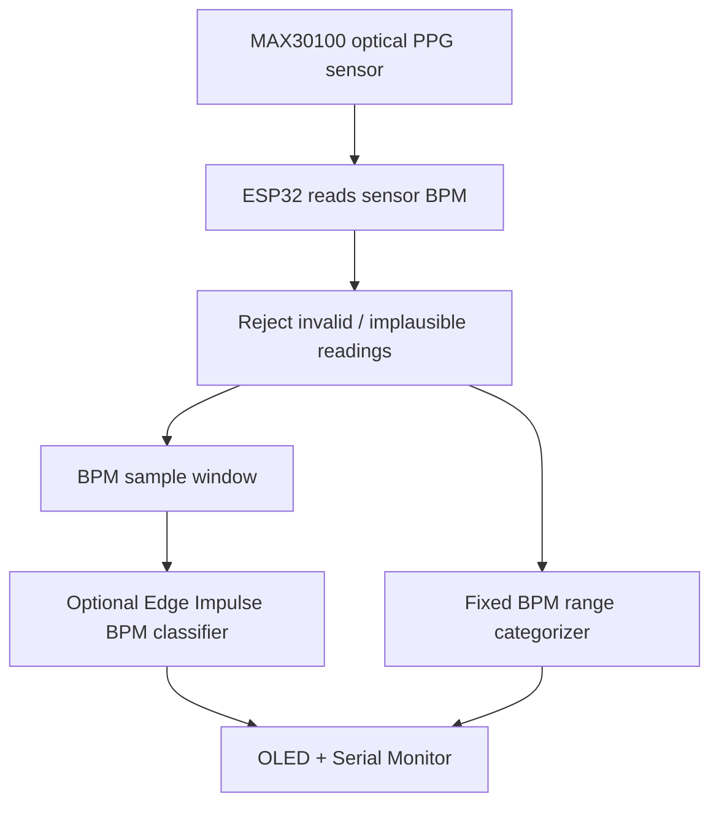

# AI-Enhanced Heart-Rate Classification using PPG and ESP32

An educational embedded-AI prototype that reads optical pulse data from a MAX30100 PPG sensor, obtains heart-rate (BPM) readings on an ESP32, and displays a simplified heart-rate category on an SH1106 OLED.

> [!CAUTION]
> **This repository currently implements heart-rate classification, not clinical arrhythmia detection.** The MAX30100 measures photoplethysmography (PPG), not an electrocardiogram (ECG). The MIT-BIH Arrhythmia Database contains ECG recordings. ECG-derived training data and live MAX30100 PPG readings are different signal modalities and must not be treated as interchangeable. This is a student prototype, not a medical device, and it must not be used to diagnose, rule out, or treat a medical condition.

## Project scope — read this first

There are two distinct project concepts:

| Track | Input | What it can claim |
|---|---|---|
| **Current implemented prototype** | MAX30100 PPG-derived BPM | Simplified heart-rate categories: Bradycardia, Normal, Tachycardia |
| **Future genuine ECG arrhythmia detector** | ECG waveform and/or ECG beat/rhythm features | Research classification of ECG beat/rhythm patterns, after compatible training, validation and hardware acquisition are implemented |

The current prototype does **not** classify MIT-BIH ECG beat morphologies from the live MAX30100 sensor. A BPM value alone cannot identify many arrhythmias: two people can have the same average heart rate while having different rhythm patterns.

## Current prototype: what it does

- Reads the MAX30100 using I²C on an ESP32.
- Uses the sensor library's heart-rate estimate as a BPM input.
- Rejects missing or implausible BPM readings before buffering them.
- Displays a simplified rate category using fixed educational ranges: below 60 BPM, 60–100 BPM, and above 100 BPM.
- Runs an exported Edge Impulse model only if the generated inference library is installed in `firmware/lib/arrhythmia_inferencing/`.
- Displays model output and confidence separately from the simple BPM range category.
- Shows the current BPM and status on an SH1106 OLED and the Serial Monitor.

The BPM thresholds are simplified adult resting-rate reference categories, not personalized clinical thresholds. Heart rate varies with age, activity, medication, fitness and other factors.

## Current system architecture



**Important:** the Edge Impulse model must have been trained on the same kind of BPM-window input, with the same ordering, units, window length and preprocessing used by the firmware. The presence of an inference function in firmware does not prove that a compatible trained model is installed or that end-to-end inference has been validated.

## Hardware

| Component | Purpose |
|---|---|
| ESP32-WROOM-32 development board | Sensor acquisition, buffering, inference and display control |
| MAX30100 module | Optical PPG pulse sensing; this prototype uses its heart-rate estimate |
| 1.3-inch SH1106 128×64 OLED | Local display |
| Breadboard and jumper wires | Prototype connections |

Both I²C modules share the ESP32 bus: SDA on GPIO 21 and SCL on GPIO 22. Read [the wiring guide](docs/wiring.md) and verify the exact breakout-board supply requirements before powering the circuit.

## Repository layout

```text
.
├── firmware/                  PlatformIO ESP32 firmware
│   ├── lib/                   Optional exported Edge Impulse library
│   ├── platformio.ini
│   └── src/main.cpp
├── data/                      BPM dataset template and data notes
├── docs/
│   ├── wiring.md
│   └── concept-redesign.md    Current scope and future ECG architecture
├── media/                     Prototype images and demo
├── report_arrhythmia.pdf      Original submitted report (review before reuse)
└── BATCH_8_...pptx.pdf        Original presentation export (review before reuse)
```

## Reproduce the current prototype

### 1. Install an optional compatible Edge Impulse model

If you have a trained and reviewed Edge Impulse model whose input is a BPM sequence matching the firmware input, export the complete Arduino/C++ library. Put the generated files in `firmware/lib/arrhythmia_inferencing/` and follow that directory's README.

The generated model is not included in this repository. Without it, firmware reports that the model is not installed and the transparent fixed BPM-range categorizer remains available.

### 2. Build and upload

Install PlatformIO, connect the ESP32, then run:

```bash
cd firmware
pio run
pio run --target upload
pio device monitor
```

The sensor needs stable finger contact and time to settle. The MAX30100 library must be serviced frequently by calling `pox.update()`; long blocking delays can degrade readings.

## Reported results and evidence status

The original submitted report contains model-performance and resource figures. Those figures should be treated as **historically reported results, not independently reproduced benchmarks**. The repository currently does not contain the complete original training dataset, preprocessing scripts, model export, split definition or logs needed to reproduce them.

Do not present a reported accuracy, inference time, RAM use or Flash use as a verified current result unless you can reproduce it from the exact model and test procedure. Model confidence for one prediction is not model accuracy.

## Limitations

- MAX30100 is a PPG sensor, not an ECG acquisition device.
- BPM-only categories are not equivalent to arrhythmia detection.
- BPM alone loses beat-to-beat timing and waveform morphology information.
- PPG can be affected by motion, finger pressure/placement, perfusion and ambient light.
- The live PPG signal is not interchangeable with MIT-BIH ECG recordings.
- A model's confidence score is not the probability that a person has a disease.
- This prototype has not been clinically validated.

## Future direction: genuine ECG arrhythmia research prototype

A genuine ECG-based research classifier would require a compatible ECG acquisition front end at runtime and an ECG model trained on ECG data. A proposed design is documented in [docs/concept-redesign.md](docs/concept-redesign.md). This is a future architecture, not a claim about the current hardware or firmware.

## References

- [MIT-BIH Arrhythmia Database — PhysioNet](https://physionet.org/content/mitdb/1.0.0/)
- [MAX30100 datasheet](https://www.analog.com/media/en/technical-documentation/data-sheets/max30100.pdf)
- [Edge Impulse documentation](https://docs.edgeimpulse.com/)

## Project team

- Hariprasath P
- Jovikesh P M
- Kathir N
