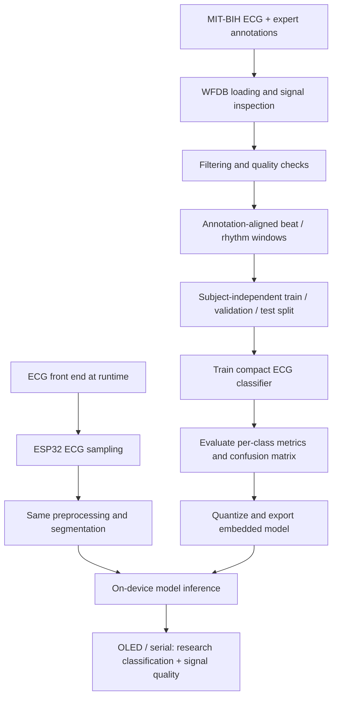

# Concept redesign: from BPM classification to a genuine ECG research pipeline

## 1. Correct project identity

The existing ESP32 + MAX30100 build is an **optical pulse / heart-rate classification prototype**. It should be presented that way. It is not technically correct to claim that this hardware captures ECG or diagnoses arrhythmia.

There are two valid directions. Choose one and keep the dataset, sensor, model input, firmware and project title consistent.

## 2. Track A — retain the existing hardware (smallest honest change)

**Suggested title:** AI-Enhanced Heart-Rate Classification using PPG and ESP32.

### Pipeline

1. MAX30100 emits optical PPG measurements.
2. ESP32 services the sensor and obtains a pulse-rate estimate.
3. Firmware rejects invalid readings and buffers a fixed-length BPM sequence.
4. Optional ML model receives that exact BPM sequence.
5. Firmware displays the BPM, a simplified rate category and (if installed) the model class/confidence.

### What the model can learn

If trained on BPM sequences, the model can learn patterns in heart-rate values. It cannot learn ECG waveform morphology from BPM alone, and it cannot reliably distinguish all arrhythmias. If only three fixed BPM ranges are used to generate labels, a machine-learning model may simply approximate those same thresholds; a transparent rule-based classifier may be more appropriate.

### Possible improvement without changing sensor

Research pulse-to-pulse interval variability from the PPG waveform, add signal-quality checks and compare regularity features across a window. Describe any output as an **irregular-pulse screening indicator for research**, not an ECG arrhythmia diagnosis. PPG pulse intervals can differ from ECG RR intervals, particularly with motion or poor perfusion.

## 3. Track B — build a genuine ECG arrhythmia research prototype

**Suggested title:** Edge-AI ECG Beat Classification on ESP32.

This direction requires a compatible ECG front end at runtime. A single-lead ECG front-end module (for example, an AD8232-based board) may be used for an educational acquisition prototype, with appropriate electrode placement, analog conditioning and electrical-safety precautions. It is not a medical-grade diagnostic system. Do not connect a person to a mains-powered or otherwise unsafe circuit; use a properly designed, battery-powered and isolated acquisition setup, and follow the module manufacturer's safety guidance.

### Offline training pipeline

1. **Obtain ECG data:** use the MIT-BIH Arrhythmia Database from PhysioNet, preserving record IDs, subject IDs, sampling frequency and expert annotations.
2. **Inspect signals:** read the waveform and annotation files with WFDB; verify channel selection, units, sampling frequency and annotation alignment.
3. **Preprocess:** remove baseline wander and power-line interference where appropriate; apply a documented band-pass filter; detect signal clipping and poor-quality segments.
4. **Create labelled examples:** use the database's expert beat annotations. If using an AAMI-style beat grouping, document the exact symbol-to-class mapping and how paced, unknown and excluded beats are handled. Do not create arrhythmia labels merely by thresholding BPM.
5. **Segment beats or rhythm windows:** for beat classification, align fixed windows around annotated beats (for example, a documented pre-R/post-R sample window). For rhythm classification, use longer continuous windows and rhythm-level labels.
6. **Split by subject/record:** keep all samples from a subject or recording in only one partition. Avoid random beat-level splitting that leaks near-duplicate beats into train and test.
7. **Train and evaluate:** compare a baseline (such as engineered RR/morphology features) with a compact 1-D CNN or another suitable model. Report per-class precision, recall, F1, confusion matrix and subject-independent test performance.
8. **Export:** quantize and export the selected model to an embedded C/C++ library only after confirming the target model input dimensions and preprocessing.

### Real-time embedded pipeline

1. ECG analog front end acquires a single-lead ECG signal.
2. ESP32 samples the conditioned ECG at the documented sampling rate.
3. Firmware applies the same filtering, normalization and segmentation used during training.
4. Firmware constructs the exact waveform/feature tensor expected by the deployed model.
5. The compact model runs locally on ESP32.
6. The device displays the predicted research class, signal-quality state and confidence.
7. If signal quality is poor or the input is out of distribution, show **unreliable / reacquire signal**, not a forced class.

### Architecture

## 4. Critical consistency rule

The model must receive the same modality and compatible representation during training and deployment.

| Training input | Runtime input | Valid? |
|---|---|---|
| ECG waveform | ECG waveform with matching preprocessing | Yes, if sampling and tensor format match |
| RR intervals from ECG | RR intervals derived from ECG | Potentially, if definitions and preprocessing match |
| BPM sequences | BPM sequences from sensor | Potentially, if units/window/preprocessing match |
| MIT-BIH ECG waveform | MAX30100 BPM | **No** |
| MIT-BIH RR-derived BPM labels | Live PPG BPM | Not automatically; domain and feature compatibility must be demonstrated |

## 5. What must change before claiming arrhythmia detection

- Replace or supplement the MAX30100 with a suitable ECG acquisition front end for the ECG track.
- Build and version the WFDB preprocessing and annotation-to-label scripts.
- Store the exact training configuration, model, class mapping and subject-wise split.
- Ensure the firmware preprocessing and input tensor exactly match training.
- Test the exported model on the ESP32 and record actual latency, RAM and Flash use.
- Evaluate on held-out subjects/records and report per-class results.
- Use careful wording: **research prototype / ECG beat classification**, not medical diagnosis.

## 6. Recommendation

For the current repository and hardware, keep Track A as the implemented project and rename it to heart-rate classification. Do not claim the Track B ECG architecture is implemented until the ECG front end, dataset pipeline, compatible model and end-to-end ESP32 test are complete. This is more credible in an interview than overstating the project.
